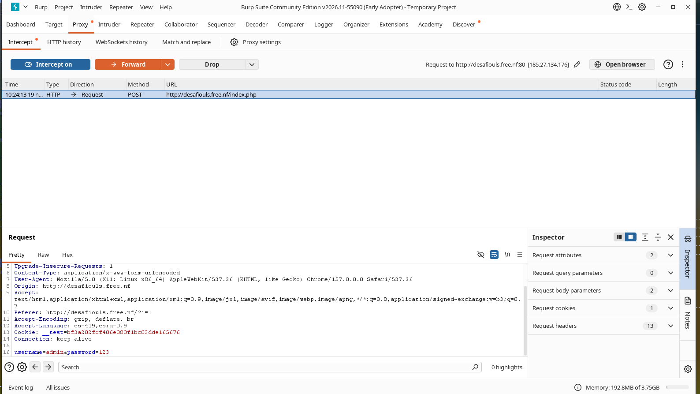
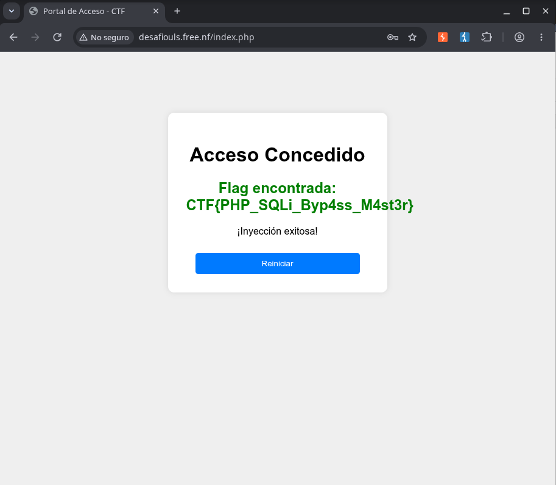

# Burp Suite — La FLAG perdida

## De qué se trataba
Había un portal de login ("Ingreso al Sistema") en `http://desafiouls.free.nf`, con sus campos de usuario y
contraseña. La idea era entrar sin tener credenciales válidas y recuperar la flag (formato `CTF{...}`), usando
Burp Suite como proxy para ver y modificar la petición del login.

## Qué hice
Lo primero que pensé es que un login así normalmente arma una consulta SQL con lo que uno escribe, y si no la
filtran bien se puede romper con una comilla. Las pistas apuntaban justo a eso: una inyección SQL (`' or 1=1-- -`).
Así que en vez de adivinar la clave, decidí interceptar el POST del login con Burp y cambiar el usuario por la
inyección antes de que llegara al servidor.

## Herramientas
- **Burp Suite Community (Proxy)** → para interceptar la petición del login y editarla antes de mandarla.
- El navegador que trae Burp (Open browser), que además pasa solo la protección anti-bot por JavaScript que
  tiene el hosting.

## Lo que hice paso a paso
1. Abrí Burp → `Proxy` → **Open browser**, y entré a `http://desafiouls.free.nf` hasta llegar al login.
2. Activé **`Intercept is on`**, escribí un usuario y clave cualquiera (`admin` / `123`) y le di a *Entrar*.
3. Burp atrapó el **POST a `/index.php`**. En el cuerpo venía:
   ```
   username=admin&password=123
   ```
4. Ahí cambié el valor del usuario por la inyección, dejando el cuerpo así:
   ```
   username=' or 1=1-- -&password=123
   ```
   La comilla cierra el string del usuario, `or 1=1` hace que la condición siempre sea verdadera, y `-- -`
   comenta el resto de la consulta (incluida la validación de la contraseña).
5. Apagué el Intercept para dejar pasar la petición y la respuesta.
6. El servidor contestó **"Acceso Concedido"** y mostró la flag.

## Evidencias




## Pistas que usé
- Que el ataque era por el login (inyección SQL), no adivinar la clave.
- El payload `' or 1=1-- -` para el bypass.

## La flag
`CTF{PHP_SQLi_Byp4ss_M4st3r}`

## Qué aprendí / análisis
Lo más entretenido fue ver que el navegador no te deja tocar lo que manda, pero con Burp en el medio sí: uno
congela la petición, la edita y la suelta. La falla real es que el login mete lo que escribe el usuario directo
en la consulta SQL, así que una comilla basta para alterarla. Me costó un poco al principio porque la página
"se quedaba cargando": era que tenía el Intercept encendido reteniendo las demás peticiones; apagándolo cargó
la respuesta con la flag.

## Lo ético
Esto lo hice sobre el entorno autorizado del curso. Interceptar o modificar tráfico y probar inyecciones solo
es legítimo sobre sistemas propios o con permiso. La forma de arreglarlo es usar **consultas parametrizadas**
(prepared statements) y nunca pegar la entrada del usuario dentro del SQL.

## Conclusión
Un login sin sanitización se salta con una inyección SQL simple. Burp sirve para auditar y manipular el tráfico
web que el navegador normalmente no deja tocar, y la defensa es validar y parametrizar todo lo que escribe el
usuario.
