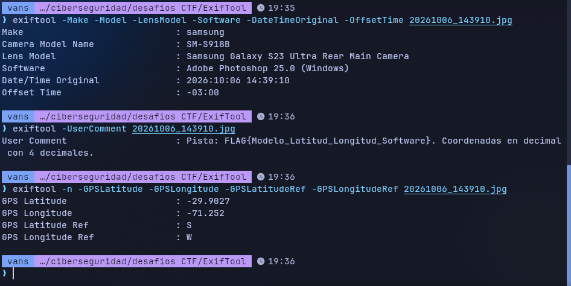

# ExifTool — Operación Anatidae

## De qué se trataba
Se "filtró" una foto de 3 patos y había sospechas de que sus metadatos estaban manipulados. La tarea era
revisar el EXIF de la imagen, decidir si era auténtica o no, y armar la flag con los datos que sacara.

## Qué hice
Una foto de celular normalmente trae un montón de metadatos: marca y modelo del equipo, fecha, ubicación GPS
y el software con que se guardó. Así que la idea era leer todo eso con `exiftool` y buscar incoherencias
(por ejemplo, que el software no sea el del celular, o que la fecha no calce).

## Herramientas
- **exiftool** → para leer todos los metadatos EXIF/GPS de la imagen.

## Lo que hice
```bash
exiftool -Make -Model -LensModel -Software -DateTimeOriginal -OffsetTime 20261006_143910.jpg
exiftool -UserComment 20261006_143910.jpg
exiftool -n -GPSLatitude -GPSLongitude -GPSLatitudeRef -GPSLongitudeRef 20261006_143910.jpg
```
Y saqué esto:
```
Make      = samsung        Model = SM-S918B (Galaxy S23 Ultra)
LensModel = Samsung Galaxy S23 Ultra Rear Main Camera
Software  = Adobe Photoshop 25.0 (Windows)
DateTimeOriginal = 2026:10:06 14:39:10   Offset = -03:00
GPS: -29.9027, -71.2520 (refs S / W)  -> La Serena / Coquimbo, Chile
UserComment = Pista: FLAG{Modelo_Latitud_Longitud_Software}. Coordenadas en decimal con 4 decimales.
```
Lo primero que me saltó a la vista fue el **Software: Adobe Photoshop (Windows)**. Una foto sacada con un
celular no se "guarda" normalmente desde Photoshop en un PC, así que esa es la señal clara de que la tocaron.
El hardware en cambio sí es coherente (el modelo SM-S918B es el Galaxy S23 Ultra, y la lente calza). Lo bueno
es que la misma foto traía una pista en el `UserComment` con el formato de la flag.

## Armar la flag
La pista decía `FLAG{Modelo_Latitud_Longitud_Software}` con las coordenadas en decimal a 4 decimales. Así que
reemplacé cada parte con el valor real:
- Modelo: `SM-S918B`
- Latitud: `-29.9027` · Longitud: `-71.2520` (ojo: S y W van con signo negativo)
- Software: `Adobe Photoshop 25.0 (Windows)`

## Evidencias



La captura muestra el modelo, el `Software = Adobe Photoshop` (la señal de edición), el `UserComment` con la
pista y las coordenadas GPS.

## Pistas que usé
La propia foto traía la pista en el `UserComment` con el formato de la flag y el detalle de las coordenadas a
4 decimales. Eso me dijo exactamente cómo armarla.

## La flag
`FLAG{SM-S918B_-29.9027_-71.2520_Adobe Photoshop 25.0 (Windows)}`

## Qué aprendí / análisis
Lo útil fue leer el EXIF completo y fijarse en el campo `Software`, que es el que delata la edición. El
`UserComment` me dio el formato justo. El detalle a cuidar fue el signo de las coordenadas: al estar en el
hemisferio Sur y al Oeste, ambas van negativas.

## Lo ético
Esto lo hice sobre una imagen del laboratorio. Leer metadatos EXIF es parte del análisis forense y el OSINT,
y es totalmente legal; eso sí, sirve para recordar que las fotos que uno sube pueden exponer su ubicación GPS
y datos del equipo.

## Conclusión
ExifTool deja ver información escondida en los metadatos y permite detectar manipulación (un software de
edición que no corresponde). Antes de compartir fotos conviene borrarles el EXIF con `exiftool -all= foto.jpg`.
