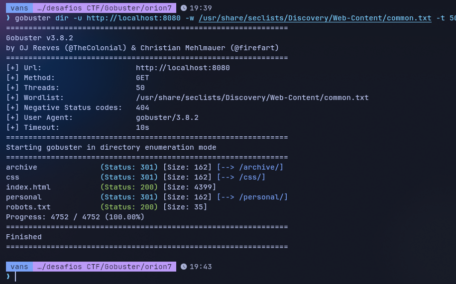
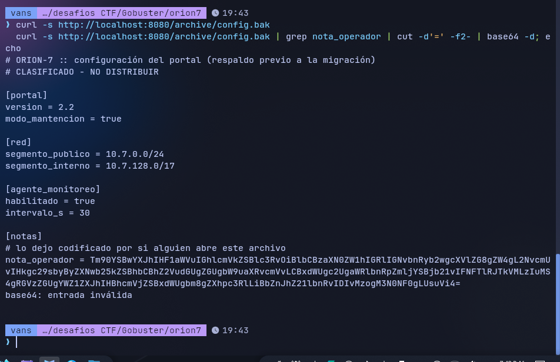
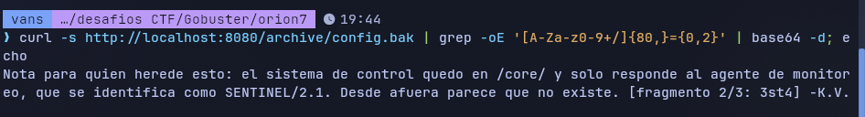
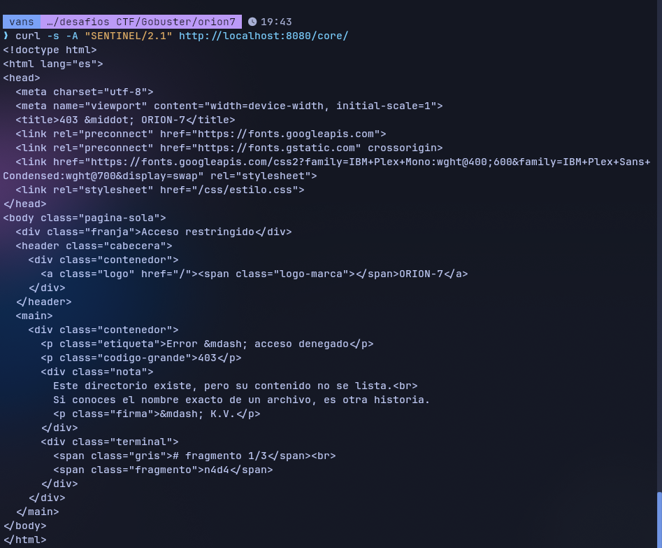
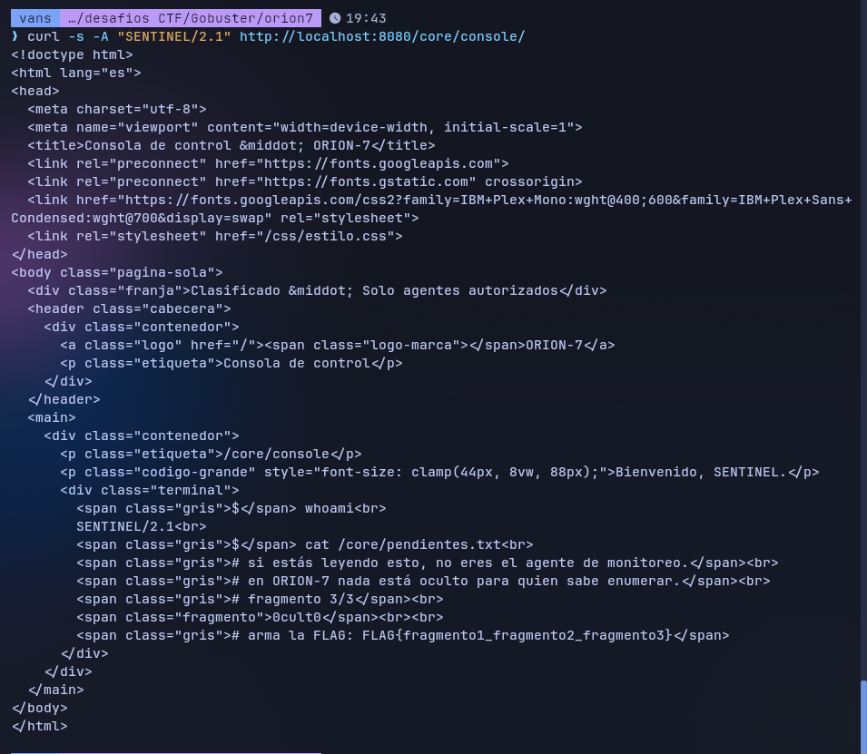

# Gobuster — ORION-7

## De qué se trataba
ORION-7 es un portal web (un contenedor Docker que se levanta en `localhost:8080`). La historia es que el
operador, K. Vidal, dejó recursos escondidos en el servidor antes de irse. La flag estaba partida en **3
fragmentos** repartidos por el sitio, y se armaba como `FLAG{fragmento1_fragmento2_fragmento3}`. Había que
resolverlo "desde afuera", sin meterse al contenedor ni abrir la imagen.

## Análisis inicial
Si hay recursos que existen pero no están enlazados en ninguna página, la forma de encontrarlos es la
**enumeración de directorios**: probar un montón de nombres de rutas con un diccionario y ver cuáles
responden. Para eso se usa gobuster con el diccionario `common.txt` de SecLists.

## Herramientas
- **gobuster** → para probar rutas por fuerza bruta con el diccionario.
- **curl** → para abrir cada ruta que aparecía (incluso cambiando el User-Agent).
- **base64** → para decodificar una nota que estaba codificada.

## Lo que hice
**1) Enumeré la raíz:**
```bash
gobuster dir -u http://localhost:8080 -w /usr/share/seclists/Discovery/Web-Content/common.txt -t 50
```
Aparecieron `archive/`, `css/`, `personal/`, `robots.txt` e `index.html`. En el `index.html` había un
comentario con `FLAG{n0_t4n_r4p1d0}`, pero el enunciado avisaba que no todo lo que parece flag lo es: era un
**señuelo**. El `robots.txt` apuntaba a `/personal/`.

**2) `/personal/`** tenía una nota del operador contando que escondió lo viejo en una carpeta sin listado y
que "no alcanzó a borrar uno de los respaldos" → eso apuntaba a `/archive/`.

**3) `/archive/`** daba 403 (sin listado), así que enumeré ahí con extensiones y encontré `config.bak`:
```bash
gobuster dir -u http://localhost:8080/archive -w .../common.txt -x txt,html,bak,old,log -t 50
```
Ese `config.bak` tenía una nota en Base64. Al decodificarla:
```bash
curl -s http://localhost:8080/archive/config.bak | grep -oE '[A-Za-z0-9+/]{80,}={0,2}' | base64 -d
# -> "...el sistema de control quedó en /core/ y solo responde al agente de monitoreo,
#     que se identifica como SENTINEL/2.1 ... [fragmento 2/3: 3st4] -K.V."
```
→ **Fragmento 2/3 = `3st4`**, y de paso la pista de que `/core/` solo responde con un User-Agent especial.

**4) `/core/`** daba 404 normal, pero poniéndole el User-Agent del "agente" respondía:
```bash
curl -s -A "SENTINEL/2.1" http://localhost:8080/core/
# -> "Este directorio existe... # fragmento 1/3  n4d4"
```
→ **Fragmento 1/3 = `n4d4`**.

**5)** Enumeré dentro de `/core/` con ese mismo User-Agent y encontré `/core/console/`:
```bash
gobuster dir -u http://localhost:8080/core -w .../common.txt -H "User-Agent: SENTINEL/2.1" -t 50
curl -s -A "SENTINEL/2.1" http://localhost:8080/core/console/
# -> "# fragmento 3/3  0cult0"
```
→ **Fragmento 3/3 = `0cult0`**.

## Evidencias



Gobuster descubre `/archive/`, `/css/`, `/personal/`, `robots.txt` e `index.html`.



El `config.bak` de `/archive/` con la nota codificada.



Al decodificar el Base64 aparece la pista de `/core/` + `SENTINEL/2.1` y el fragmento 2/3 `3st4`.



`/core/` solo responde con `User-Agent: SENTINEL/2.1`, y ahí está el fragmento 1/3 `n4d4`.



`/core/console/` muestra el fragmento 3/3 `0cult0` y la instrucción para armar la flag.

## Pistas que usé
Las que iban apareciendo dentro del propio desafío: el `robots.txt`, la nota de `/personal/` y la nota Base64
de `config.bak`. Todas me fueron encadenando hacia el siguiente paso.

## La flag
Juntando los 3 fragmentos: **`FLAG{n4d4_3st4_0cult0}`** ("nada está oculto").
(El `FLAG{n0_t4n_r4p1d0}` del index era señuelo.)

## Qué aprendí / análisis
Lo entretenido fue que no bastaba con enumerar la raíz: cada pista llevaba a otra (`robots.txt` → nota →
`config.bak` → `/core/` escondido tras un User-Agent). Hay que seguir cada ruta, probar extensiones y hasta
cambiar cabeceras. Y, de nuevo, cuidado con los señuelos: hay que verificar cada "flag".

## Lo ético
El único objetivo permitido era `http://localhost:8080` en mi propio equipo, y no me metí al contenedor ni a
la imagen (esa era la regla). La defensa de esto es clara: lo que no está enlazado no está protegido. Filtrar
por User-Agent o esconder rutas es "seguridad por oscuridad" y no sirve; lo que hace falta es autenticación y
control de acceso de verdad, y no dejar respaldos como `config.bak` accesibles.

## Conclusión
Gobuster sirve para mapear la parte oculta de un sitio. Una cadena de recursos "escondidos" cae con
enumeración y paciencia; la única defensa seria es el control de acceso, no esconder las rutas.
