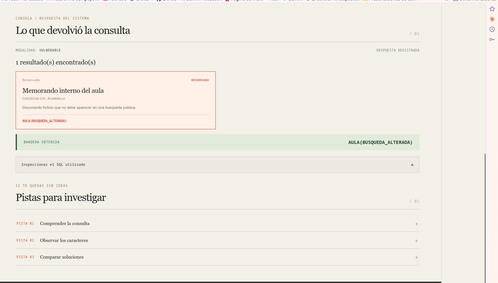
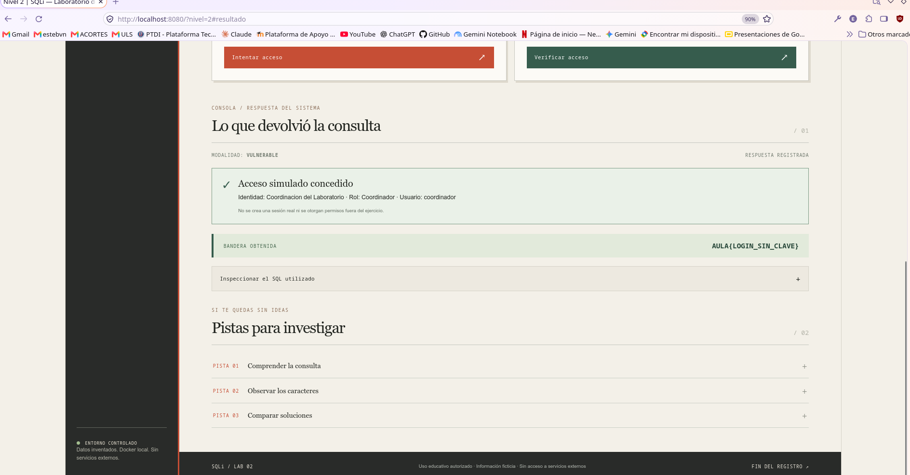

# Inyección SQL — Laboratorio de 2 niveles

## De qué se trataba
El desafío es un sitio web de práctica (PHP + MariaDB) que corre en Docker en `localhost:8080`. Tiene dos
niveles, cada uno con un formulario que arma la consulta SQL pegando directamente lo que uno escribe (el
clásico error que abre la puerta a la inyección). La idea era aprovechar eso para sacar información que no
debería verse. Hay una versión "vulnerable" y otra "protegida" para comparar; las flags solo salen en la
vulnerable.

## Qué hice
Levanté el laboratorio con `docker compose up --build -d` y entré a `http://localhost:8080`. Antes de tirar
nada probé a usar los formularios normal, para ver cómo se comportaban, y después pensé en qué pasaría si
metía una comilla para "romper" la consulta. Como el propio enunciado hablaba de un recurso no publicado y de
entrar como coordinador, ya tenía claro el objetivo de cada nivel.

## Herramientas
- **Navegador** para usar los formularios y ver los resultados.
- **curl** para repetir las inyecciones desde la terminal y dejar la evidencia en texto.
- Nada más: todo se resuelve escribiendo la entrada correcta, sin programas raros.

## Nivel 1 — la búsqueda
La consulta era más o menos así:
```sql
SELECT ... FROM recursos WHERE titulo LIKE '%LO_QUE_ESCRIBO%' AND publico = 1
```
O sea, solo muestra lo marcado como público. Para que apareciera el recurso oculto (`publico = 0`) metí esto
en el buscador:
```
zzz%' OR publico=0 -- -
```
Con eso la consulta queda como "busca algo que no existe **o** que sea no público", y el `-- -` comenta el
resto. Resultado: salió el **"Memorando interno del aula"** (reservado) y con él la flag.

→ **`AULA{BUSQUEDA_ALTERADA}`**

## Nivel 2 — el login
Acá la consulta pegaba el usuario y la clave:
```sql
SELECT ... FROM cuentas WHERE usuario = 'USUARIO' AND clave_demo_sha256 = SHA2('CLAVE', 256)
```
Para entrar como coordinador sin saber su contraseña, en el campo usuario puse:
```
coordinador' -- -
```
y en la clave cualquier cosa. El `-- -` comenta toda la parte de la contraseña, así que la base solo verifica
el usuario y me deja pasar como **coordinador**. Ahí salió la segunda flag.

→ **`AULA{LOGIN_SIN_CLAVE}`**

## Evidencias



**Nivel 1:** con el payload en la búsqueda, la consola muestra el "Memorando interno del aula" (Reservado) y
la bandera `AULA{BUSQUEDA_ALTERADA}`.



**Nivel 2:** con `coordinador' -- -` en el usuario, el sistema concede "Acceso simulado" como Coordinador y
entrega la bandera `AULA{LOGIN_SIN_CLAVE}`.

## Pistas que usé
Las del propio enunciado: que en el nivel 1 había que "obtener un recurso no publicado" y que en el nivel 2
había que "acceder como coordinador sin conocer su contraseña". Eso me dijo exactamente qué buscar en cada caso.

## Las flags
- Nivel 1: **`AULA{BUSQUEDA_ALTERADA}`**
- Nivel 2: **`AULA{LOGIN_SIN_CLAVE}`**

## Qué aprendí / análisis
Lo interesante fue comparar las dos versiones: en la "protegida" los mismos payloads no hacen nada, porque el
dato se pasa aparte (consultas preparadas) en vez de pegarlo en el SQL. Ahí se ve clarito que el problema no
es el usuario malicioso, sino concatenar la entrada en la consulta. Lo que más me costó fue cerrar bien las
comillas; si te equivocas en una, la consulta falla y no muestra nada.

## Lo ético
Todo esto lo hice en el laboratorio local (`localhost:8080`), en mi propio equipo, que es justo para lo que
está hecho. Probar inyecciones en una web real sin permiso es delito. La forma de arreglarlo es la que muestra
la versión protegida: usar **consultas parametrizadas** y nunca pegar lo que escribe el usuario dentro del SQL.

## Conclusión
Con dos entradas bien pensadas se puede saltar un filtro ("solo públicos") y un login completo. La defensa no
es prohibir comillas, sino separar el código SQL de los datos del usuario.
