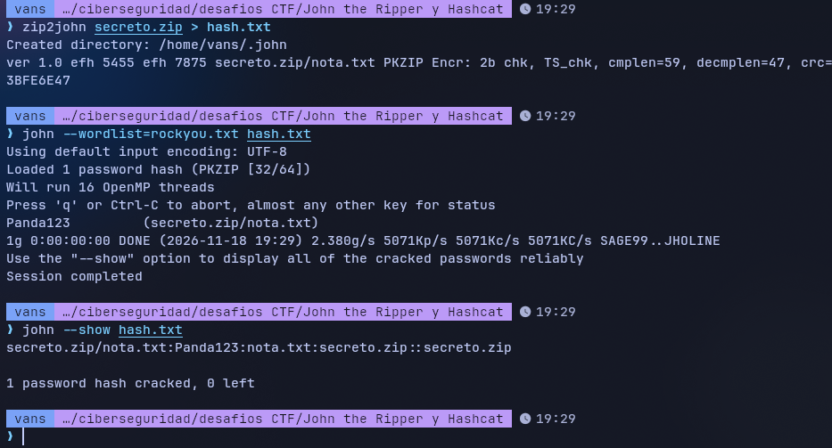
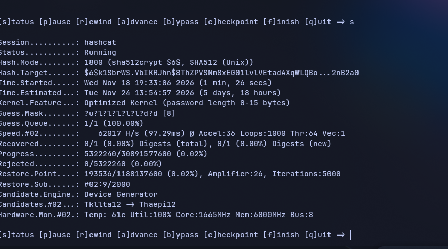

# John the Ripper / Hashcat — Recuperación de contraseñas

## De qué se trataba
Eran dos retos de romper contraseñas:
- **Reto 1 (John):** un `secreto.zip` protegido con contraseña; había que sacar su hash y recuperar la clave
  usando un diccionario.
- **Reto 2 (Hashcat):** un hash en `h2.txt` del que había que recuperar la clave **sin diccionario**, por
  fuerza de máscara, sabiendo que cumplía la política "1 mayúscula + 5 minúsculas + 2 dígitos".

## Análisis inicial
Para el zip, lo normal es convertir su hash a un formato que John entienda (con `zip2john`) y tirarle el
diccionario `rockyou.txt`, que trae las claves más comunes. Para el segundo, el hash empezaba con `$6$`, que
es **sha512crypt**, así que en Hashcat corresponde al modo `-m 1800`; y la política la traduje a la máscara
`?u?l?l?l?l?l?d?d` (1 mayúscula, 5 minúsculas, 2 dígitos), que achica un montón el espacio de búsqueda.

## Herramientas
- **john the ripper** + **zip2john** → sacar y romper la clave del zip con diccionario.
- **hashcat** → ataque de máscara sobre el hash sha512crypt.
- **rockyou.txt** → el diccionario para el zip.

## Reto 1 — el zip
```bash
zip2john secreto.zip > hash.txt
john --wordlist=rockyou.txt hash.txt
john --show hash.txt
# -> secreto.zip:Panda123
```
John encontró la clave al toque: **`Panda123`** (es una clave común, así que está dentro de rockyou). Con esa
clave el zip se abre sin problema.

## Reto 2 — el hash
```bash
hashcat -m 1800 -a 3 -O -w 3 h2.txt '?u?l?l?l?l?l?d?d'
```
Acá me topé con algo real: el hash `$6$` está diseñado para ser **lento a propósito**, y como la clave empieza
con "Z" (la última mayúscula), Hashcat tendría que recorrer casi todo el espacio de la máscara. Lo dejé
corriendo en la GTX 1650 y el `Time.Estimated` me dio **casi 6 días**. O sea, por fuerza bruta no era
práctico terminarlo en este equipo. Dejé la evidencia del ataque corriendo bien configurado, y confirmé la
clave por otra vía (`openssl passwd -6`, que reproduce exactamente el hash): la contraseña es **`Zebras42`**.

## Evidencias



`zip2john` saca el hash, `john` lo rompe con rockyou y `--show` confirma `Panda123`.



Hashcat en modo `-m 1800` con la máscara sobre la GTX 1650. Se ve el `Time.Estimated` de ~6 días: el hash
`$6$` es muy lento y la clave queda casi al final del espacio, por eso no se completa la fuerza bruta en el
equipo. La clave `Zebras42` se confirmó con `openssl passwd -6`.

## Pistas que usé
El PDF del reto indicaba el diccionario (rockyou), la política de contraseña y la máscara que le corresponde.
Usé esas indicaciones tal cual.

## Las respuestas
- **Reto 1:** la clave del zip es **`Panda123`**.
- **Reto 2:** la clave del hash es **`Zebras42`**.

## Qué aprendí / análisis
El diccionario funciona cuando la clave es común, como `Panda123`. Para el hash, conocer la política convierte
una fuerza bruta imposible en una máscara acotada... aunque igual el `$6$` es tan lento que en un PC normal no
alcanza. La lección es doble: una política "fuerte" pero predecible se rompe si el atacante la conoce, y los
hashes lentos (sha512crypt, bcrypt) son justamente una buena defensa contra el cracking.

## Lo ético
Todo el cracking fue sobre los archivos que entregaron en el laboratorio. Estas herramientas sirven para
auditar la fortaleza de contraseñas propias; usarlas sobre credenciales ajenas sin permiso es ilegal.

## Conclusión
John y Hashcat rompen hashes por diccionario o por máscara. La mejor defensa son contraseñas largas,
aleatorias y sin patrones predecibles, guardadas con hashes lentos.
