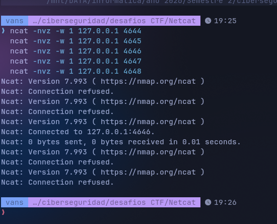
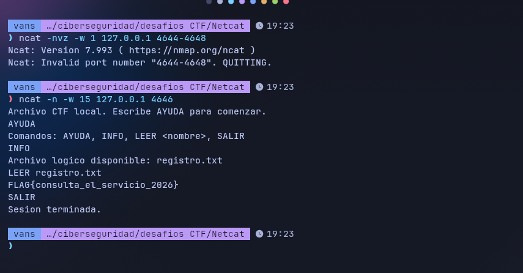

# Netcat — El registro perdido

## De qué se trataba
Este reto venía con un archivo `servidor_ctf.py` que uno levanta en su propio equipo. Monta un servicio que
escucha por la red (en 127.0.0.1, o sea, local), y la idea era conectarse con Netcat, encontrar en qué puerto
estaba escuchando y "conversar" con él hasta que soltara la flag. La regla era no mirar el código del
servidor, solo hablarle desde afuera.

## Qué hice
El enunciado decía que el servicio estaba en 127.0.0.1, por TCP, en algún puerto entre el 4644 y el 4648.
Así que lo primero era escanear ese rango para ver cuál estaba abierto, y después conectarme y ver qué me
respondía. Pensé que, como pasa con muchos servicios, probablemente tuviera un comando tipo "ayuda" para
saber qué se puede pedir.

## Herramientas
- **python3** → para levantar el servidor (`servidor_ctf.py --modo reto`).
- **ncat (Netcat)** → para escanear los puertos y después hablar con el servicio.

## Lo que hice
Primero dejé el servidor corriendo en una terminal:
```bash
python3 servidor_ctf.py --modo reto
# -> CTF reto escuchando en 127.0.0.1:4646
```
En otra terminal escaneé el rango. Ojo: `ncat` no acepta un rango de una (`4644-4648` da error), así que
probé puerto por puerto:
```bash
for p in 4644 4645 4646 4647 4648; do ncat -nvz -w 1 127.0.0.1 $p; done
```
De todos, solo el **4646** respondió "Connected"; el resto daba "Connection refused". Así que me conecté ahí
y empecé a tirar comandos:
```bash
ncat -n -w 15 127.0.0.1 4646
AYUDA                 # -> Comandos: AYUDA, INFO, LEER <nombre>, SALIR
INFO                  # -> Archivo logico disponible: registro.txt
LEER registro.txt     # -> FLAG{consulta_el_servicio_2026}
```
`AYUDA` me mostró los comandos, `INFO` me dijo que había un `registro.txt`, y al pedir `LEER registro.txt`
soltó la flag.

## Evidencias



Solo el 4646 responde `Connected`; los demás `Connection refused`.



La conversación `AYUDA → INFO → LEER registro.txt`, que termina entregando la flag.

## Pistas que usé
El enunciado me dio el rango de puertos y la recomendación de escanear antes de conectar. El menú de comandos
(`AYUDA`) lo da el mismo servicio. No necesité nada más.

## La flag
- **Puerto:** 4646
- **Flag:** `FLAG{consulta_el_servicio_2026}`

## Qué aprendí / análisis
Lo clave fue entender que había que *explorar* el servicio en vez de adivinar: casi todos los servicios te
dicen qué pueden hacer si les preguntas. El `AYUDA` fue la llave. Un detalle que me hizo perder un rato fue
el timeout de 15 segundos: si te quedas pensando, se corta la conexión y hay que reconectar.

## Lo ético
Todo corrió en 127.0.0.1, o sea en mi propio equipo; no toqué ningún sistema de otra persona. Netcat es una
herramienta normal para diagnosticar redes; usarla contra servicios ajenos sin permiso sí sería ilegal.

## Conclusión
Con Netcat uno puede escanear puertos y hablar a mano con un servicio TCP. La enseñanza es partir enumerando
lo que hay disponible (`AYUDA`/`INFO`) antes de lanzarse a probar cosas al azar.
