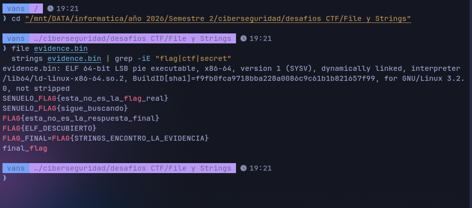

# file / strings — La evidencia perdida

## De qué se trataba
Me pasaron un archivo llamado `evidence.bin` con una nota que decía "la extensión puede mentir, antes de
buscar información descubre qué tienes realmente delante". La idea era averiguar qué tipo de archivo era de
verdad y, sin ejecutarlo (solo análisis estático), encontrar las 2 flags escondidas adentro.

## Qué hice
Lo primero que pensé con eso de "la extensión miente" fue no confiar en el `.bin` y ver qué era en realidad.
Para eso la herramienta de siempre es `file`, que mira la firma del archivo y no la extensión. Después, como
las flags suelen quedar como texto dentro del binario, se me ocurrió sacar todas las cadenas con `strings` y
filtrar las que parecieran flags.

## Herramientas
- **file** → para saber el tipo real del archivo por su firma.
- **strings** → para sacar el texto legible que tiene dentro.
- **grep** → para filtrar esas cadenas y quedarme con las que decían "flag".

## Lo que hice
```bash
file evidence.bin
# -> ELF 64-bit LSB pie executable, x86-64, ... not stripped

strings evidence.bin | grep -iE "flag|ctf|secret"
```
Y me salió esto:
```
SENUELO_FLAG{esta_no_es_la_flag_real}
SENUELO_FLAG{sigue_buscando}
FLAG{esta_no_es_la_respuesta_final}
FLAG{ELF_DESCUBIERTO}
FLAG_FINAL=FLAG{STRINGS_ENCONTRO_LA_EVIDENCIA}
```
Lo primero que vi es que el archivo era en realidad un **ejecutable ELF** de Linux, no un `.bin` cualquiera
(ahí ya calzaba lo de "la extensión miente"). Y con `strings` aparecieron varias cadenas con pinta de flag,
pero la mitad eran trampa: las que empiezan con `SENUELO_` o las que dicen "no es la real". Me quedé con las
dos que tenían sentido: la que premia haber descubierto el ELF, y la marcada con `FLAG_FINAL=`.

## Evidencias



La captura muestra `file` identificando el ELF y `strings | grep` con las flags reales junto a los señuelos.

## Pistas que usé
Solo la del enunciado: "la extensión puede mentir", que fue justo lo que me llevó a usar `file` primero en
vez de confiar en el nombre del archivo.

## Las flags
- **FLAG 1:** `FLAG{ELF_DESCUBIERTO}` (la de la fase 1, por haber descubierto que era un ELF).
- **FLAG 2 (final):** `FLAG{STRINGS_ENCONTRO_LA_EVIDENCIA}` (la de la línea `FLAG_FINAL=`).

## Qué aprendí / análisis
Lo que más funcionó fue partir con `file` antes de asumir nada por la extensión. Lo complicado no fue
encontrar las flags, sino darse cuenta de cuáles eran señuelos: no toda cadena con `FLAG{...}` es la
respuesta, hay que mirar el contexto (el prefijo `SENUELO_`, el `FLAG_FINAL=`, etc.).

## Lo ético
Todo lo hice sobre un archivo del laboratorio y de forma estática, sin ejecutarlo, que era justo la regla del
reto. En la vida real abrir o correr un binario desconocido puede ser peligroso; por eso lo seguro es
analizarlo sin ejecutarlo, como acá.

## Conclusión
Con dos comandos básicos (`file` y `strings`) uno puede saber qué es realmente un archivo y sacarle la
información escondida. La moraleja es no fiarse de la extensión y no caer en los señuelos.
